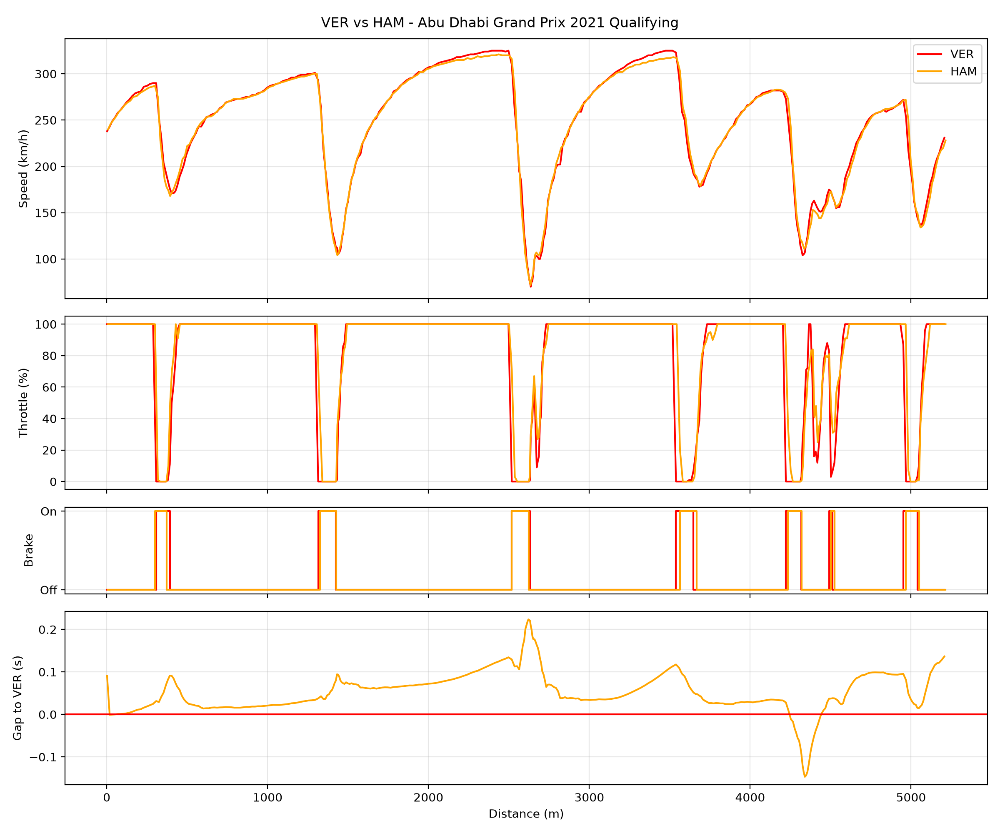

# F1 Lap Comparison

Personal Python project comparing two F1 drivers' fastest laps from any official session, using real car telemetry from the FastF1 library.

It plots speed, throttle, brake and the running time gap against distance around the lap, so you can see exactly where one driver was quicker than the other.

## Example

## How it works

- Downloads the session's timing and telemetry with FastF1
- Finds each driver's fastest lap and adds a distance column to the telemetry
- Plots everything against distance (not time), so both laps line up at the same point on track
- Calculates the time gap at every point using linear interpolation, since the two laps are sampled at different moments

## How to run it

    pip install -r requirements.txt
    python lap_compare.py

Then follow the menus to choose a year, race, session and two drivers.

## Limitations

- Brake data is only on/off, not brake pressure
- Telemetry is sampled roughly 4–5 times per second, so exact braking points are approximate
- Some sessions have gaps in the data, which can show up as jumps in the graphs